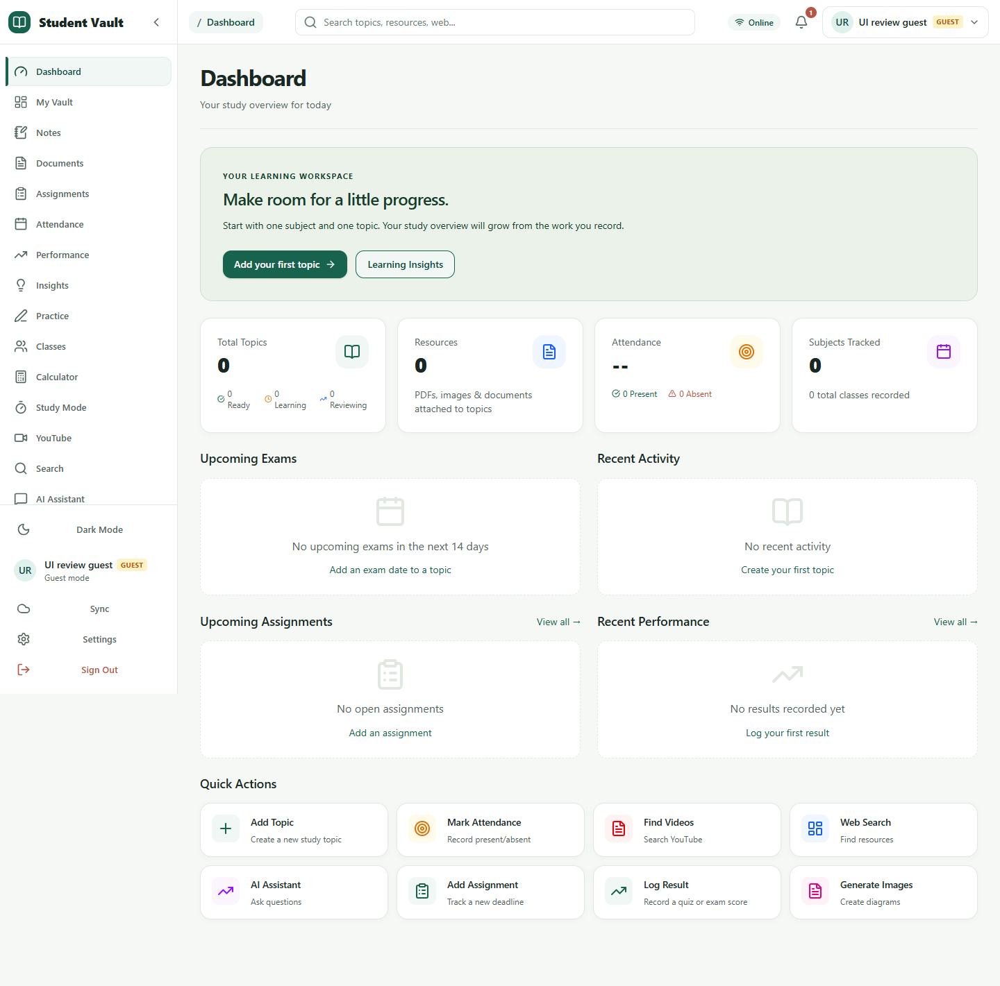
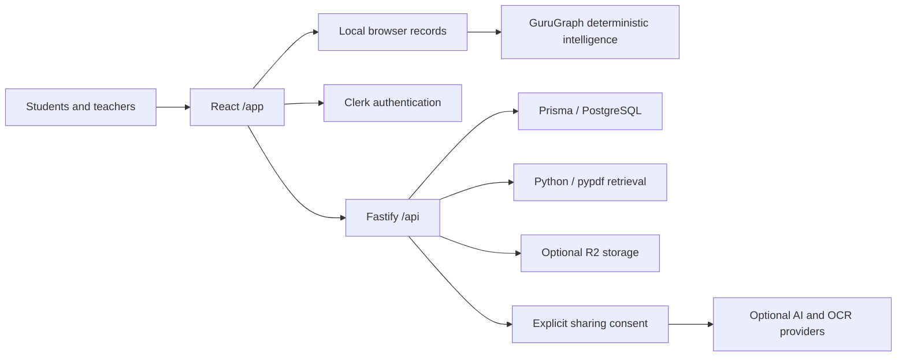

# Student-Vault × GuruGraph

An academic workspace combining student organization, explainable learning intelligence, adaptive practice, and teacher-supported interventions.

[](https://github.com/risheeth26233/student-vault/actions/workflows/verify.yml)

### [Open the public preview](https://student-vault-467y.onrender.com/app/)

**Release status: deployed, partially verified.** The real React app and API are hosted together on Render's free plan. HTTPS page/assets, deep links, health and anonymous access denials passed. Local guest tools are available; Clerk configuration, demo-database migration and signed-in student/teacher verification are pending. Database readiness currently fails until secure configuration is completed. This is not a production-ready release.



The screenshot shows the actual application with an empty, synthetic guest profile, captured during the 2026-11-03 UI review. It is not evidence of cloud authentication or a deployed service.

## Explore the application

- **Local student workspace:** open `/app/`, continue as guest or create a local profile. Add subjects/topics in My Vault, notes/resources, attendance, assignments and assessment results. These records stay in this browser until an explicitly supported cloud sync is requested.
- **Learning Insights:** open Insights after recording evidence. Expand explanations to distinguish observations from estimates. Missing evidence is shown honestly.
- **Practice:** open Practice, select a topic, upload supported page images, and review transcription. Manual transcription works without OCR. Generated practice and progress summaries have visible limitations.
- **Cloud student/teacher workflows:** use **Sign in for cloud and classroom access** with Clerk. A teacher must be allowlisted by the backend administrator. Create a class, have a separately authenticated student join with its private code, then review that student's authorized evidence and propose/approve an intervention. Students start/complete approved work; teachers review feedback and paired reassessment. A local guest does not have teacher permissions.
- **Study assistance:** select topic resources in Study Mode to retrieve PDF page excerpts. Python/pypdf performs extraction on the backend. External AI/OCR sharing requires explicit consent and configured providers. Unconfigured providers return honest fallbacks, not invented answers. Cloud resource access requires sign-in.

There are no shared public passwords, anonymous teacher bypasses, or seeded records in an unidentified remote database.

## Features and architecture

| Area | Implemented capabilities |
| --- | --- |
| Student workspace | Topics/checklists, notes, resources, attendance, assignments, performance, calculator, local storage and scoped cloud sync |
| GuruGraph | Deterministic evidence normalization, mastery estimates, gap classification, explanations and insufficient-evidence states |
| Practice | Multi-page handwriting review, consent-gated OCR boundary, manual transcription, deterministic adaptive practice and progress |
| Teachers and interventions | Owned classrooms, explicit enrollment, scoped evidence, intervention review/history, student follow-through and reassessment |
| Study ecosystem | Local PDF extraction, relevant-page retrieval, optional provider answers and citation validation |
| Release hardening | Clerk token checks, ownership enforcement, signed webhooks, bounded requests, rate limits, readiness and CI with isolated PostgreSQL |



**DETECT → UNDERSTAND → EXPLAIN → INTERVENE → PRACTICE → REASSESS → CLOSE GAP → MEASURE IMPACT** describes the intended learning loop. The implementation distinguishes recorded evidence from estimates; a paired score change does not prove a gap is closed or establish causal impact.

The actual stack is React 19, TypeScript, Vite, TanStack Query, Tailwind CSS, Radix UI and Framer Motion; Fastify, Zod, Clerk, Prisma/PostgreSQL; Python/pypdf for PDFs. Optional integrations include OpenAI, Anthropic, R2, Brave, YouTube and Fal.

## Release and maintenance

The repository includes a single-service [Dockerfile](Dockerfile) and free-plan [Render Blueprint](render.yaml). The same service serves the real frontend and API; `/` redirects to `/app/` and deep links receive the SPA. The legacy root files remain preserved in Git but are not the deployment homepage. No database migrations run automatically at service startup.

See [deployment and recovery](docs/DEPLOYMENT.md) for account connection, database identification, secure environment setup, controlled migrations, read-only release checks, backup/rollback and cold-start limitations. Node 22.12+ and Python 3 with pypdf are required for the complete runtime. Never put database URLs or server API keys in `VITE_*` variables.

## Current implementation status

The roadmap has exactly seven phases. Phases 1–6 are implemented with automated coverage; teacher/intervention persistence and both migrations passed against isolated PostgreSQL locally and in prior CI. Phase 7 release hardening is in progress. The public environment passed read-only HTTP checks, but live Clerk sign-in, public persistence, browser workflows and external AI/OCR remain unverified. No remote Neon migration is claimed. See [the progress record](docs/PROJECT_PROGRESS.md) for evidence, historical checkpoints and limitations.

The React application under `frontend/` is the primary app at `/app`; the legacy root application remains preserved. Teacher and student APIs enforce role and object ownership on the backend. See [frontend setup](frontend/README.md) and [backend setup](backend/README.md).

## Legacy browser app

1. Open `index.html` in a browser to use the preserved legacy app. For the primary React app, follow [frontend setup](frontend/README.md).
2. Add a subject, topic, and optional exam date.
3. Write revision notes and tick the checklist as you prepare.
4. Use **Attach PDF or photo** to keep study resources with the right topic.
5. Choose **Browse sources** to search the web for that topic.

Topics and notes are stored in this browser. PDF and photo attachments are stored in the browser database on this computer. Do not clear browser site data if you want to keep the saved materials.

---

## Backend API

The backend provides a REST API for persisting Student Vault data to PostgreSQL with Clerk authentication, Cloudflare R2 file storage, AI providers, YouTube Data API v3, Brave Search API, and Image Generation (Fal.ai/DALL-E).

### Quick Start

```bash
cd backend
cp .env.example .env
# Configure DATABASE_URL for an empty, verified local development database and add Clerk keys.
npm install
npm run prisma:generate
npm run prisma:migrate:deploy
npm run dev
```

Do not point migration commands at an unknown or populated remote database. For isolated PostgreSQL integration tests, see the setup and explicit test-database guard in [the progress record](docs/PROJECT_PROGRESS.md).

Server runs at `http://localhost:3000`

### Environment Variables

See `backend/.env.example` for all options. Required:

- `DATABASE_URL` - PostgreSQL connection string
- `FRONTEND_URL` - CORS origin (default: http://localhost:5173)
- `CLERK_SECRET_KEY` - Clerk secret key for authentication
- `CLERK_PUBLISHABLE_KEY` - Clerk publishable key for frontend
- `CLERK_WEBHOOK_SECRET` - Clerk webhook secret for user sync

For Cloud Sync and R2 storage:

- `R2_ACCOUNT_ID` - Cloudflare R2 account ID
- `R2_ACCESS_KEY_ID` - R2 access key ID
- `R2_SECRET_ACCESS_KEY` - R2 secret access key
- `R2_BUCKET_NAME` - R2 bucket name
- `R2_PUBLIC_URL` - R2 public URL (optional, for direct access)

For AI services:

- `OPENAI_API_KEY` - OpenAI API key (for GPT models and embeddings)
- `ANTHROPIC_API_KEY` - Anthropic API key (for Claude models)

For YouTube search:

- `YOUTUBE_API_KEY` - YouTube Data API v3 key (from Google Cloud Console)

For web search:

- `BRAVE_SEARCH_API_KEY` - Brave Search API key (from https://brave.com/search/api/)

For image generation:

- `FAL_API_KEY` - Fal.ai API key (recommended, from https://fal.ai) - supports Flux, SDXL, and other models
- `OPENAI_API_KEY` - OpenAI API key (fallback for DALL-E 2/3)

### Authentication

All API endpoints (except `/api/health` and `/api/webhooks/clerk`) require a valid Clerk session token in the `Authorization` header:

```
Authorization: Bearer <session_token>
```

The session token is obtained from Clerk on the frontend after user sign-in.

### API Endpoints

#### Health (Public)
- `GET /api/health` - Health check

#### Clerk Webhook (Public)
- `POST /api/webhooks/clerk` - Handle Clerk user events (user.created, user.updated, user.deleted)

#### Sync (Authenticated)
- `GET /api/sync/status` - Get sync status (last sync time, server version)
- `POST /api/sync/pull` - Pull all user data from server (server -> client)
- `POST /api/sync/push` - Push local changes to server with conflict resolution (client -> server)
- `GET /api/sync/r2/upload-url` - Get presigned URL for uploading a file to R2
- `GET /api/sync/r2/download-url` - Get presigned URL for downloading a file from R2

#### AI (Authenticated)
- `POST /api/ai/chat` - Chat with AI assistant
- `POST /api/ai/chat/stream` - Stream chat with AI assistant
- `GET /api/ai/providers` - List available AI providers
- `POST /api/ai/study` - Retrieve selected owned resources and optionally send relevant excerpts to a provider after explicit consent

#### Handwriting and practice (Authenticated)
- `GET /api/handwriting/status` - Check configured extraction provider
- `POST /api/handwriting/extract` - Consent-gated OCR extraction for validated images

#### Teacher and intervention workflows (Authenticated)
- `GET|POST /api/teacher/classes` - List or create teacher-owned classrooms
- `GET /api/teacher/classes/:id/students` - View active enrolled students and recorded evidence in a teacher-owned classroom
- `POST /api/teacher/enrollments/accept` - Student joins by a teacher-shared code
- `/api/teacher/classes/:id/interventions` and `/api/teacher/interventions/:id` - Propose, list, approve, or cancel intervention plans
- `/api/student/interventions` - Student reads and updates their own intervention lifecycle

#### YouTube (Authenticated)
- `POST /api/youtube/search` - Search YouTube videos
- `GET /api/youtube/videos/:id` - Get video details by ID
- `GET /api/youtube/status` - Check YouTube service configuration

#### Search (Authenticated)
- `POST /api/search` - Search the web for educational resources
- `GET /api/search/status` - Check search service configuration

#### Images (Authenticated)
- `POST /api/images/generate` - Generate an educational image/diagram
- `GET /api/images/status` - Check image generation service configuration

#### Topics (Authenticated)
- `GET /api/topics` - List topics (query: subject, status, search, limit, offset)
- `GET /api/topics/:id` - Get topic by ID
- `POST /api/topics` - Create topic
- `PUT /api/topics/:id` - Update topic
- `PATCH /api/topics/:id/checklist` - Update checklist
- `DELETE /api/topics/:id` - Delete topic

#### Attendance (Authenticated)
- `GET /api/attendance` - List attendance subjects with records
- `GET /api/attendance/stats` - Overall attendance statistics
- `GET /api/attendance/:id` - Get attendance subject
- `POST /api/attendance` - Create attendance subject
- `PUT /api/attendance/:id` - Update attendance subject
- `POST /api/attendance/:id/records` - Add record (present/absent)
- `DELETE /api/attendance/:id/records/undo` - Undo last record
- `PUT /api/attendance/:id/target` - Update target percentage
- `DELETE /api/attendance/:id` - Delete attendance subject

#### Resources (Authenticated)
- `GET /api/resources` - List resources (query: topicId, limit, offset)
- `GET /api/resources/:id` - Get resource
- `POST /api/resources` - Create resource (base64 data URL or R2 key)
- `DELETE /api/resources/:id` - Delete resource
- `DELETE /api/resources/topic/:topicId` - Delete all resources for topic

#### Import (v1) (Authenticated)
- `POST /api/import/v1` - Import Student Vault backup v1

**Request body:**
```json
{
  "version": 1,
  "exportedAt": "2026-01-15T10:30:00.000Z",
  "profile": { "name": "John Doe" },
  "topics": [{ "id": "1", "subject": "Math", "title": "Calculus", "examDate": "2026-06-01T00:00:00.000Z", "notes": "Review limits", "status": "learning", "checklist": { "understand": true, "practice": false, "revise": false }, "createdAt": "2026-01-01T00:00:00.000Z" }],
  "attendanceSubjects": [{ "id": "1", "name": "Math", "target": 75, "records": ["present", "absent", "present"] }],
  "resources": [{ "id": "1", "topicId": "1", "name": "notes.pdf", "type": "application/pdf", "size": 1024, "data": "data:application/pdf;base64,...", "addedAt": "2026-01-01T00:00:00.000Z" }]
}
```

**Response:**
```json
{
  "success": true,
  "message": "Backup imported successfully from 1/15/2026, 10:30:00 AM",
  "stats": { "topicsImported": 1, "attendanceSubjectsImported": 1, "resourcesImported": 1 }
}
```

### Sync Protocol (Phase 1)

The sync protocol uses a version-based conflict resolution strategy:

1. **Pull**: Client calls `POST /api/sync/pull` to get all server data + a `serverVersion` timestamp
2. **Local changes**: Client makes changes locally (localStorage/IndexedDB)
3. **Push**: Client calls `POST /api/sync/push` with changes + `clientVersion` (last known serverVersion)
4. **Conflict detection**: Server compares `updatedAt` timestamps against `clientVersion`
5. **Resolution**: Conflicts are returned to client for manual resolution; non-conflicting changes are applied

**Push Request Body:**
```json
{
  "profile": { "name": "John Doe" },
  "topics": [{ "id": "1", "subject": "Math", "title": "Calculus", ..., "_deleted": false }],
  "attendanceSubjects": [{ "id": "1", "name": "Math", "target": 75, "records": [...], "_deleted": false }],
  "resources": [{ "id": "1", "topicId": "1", "name": "notes.pdf", "mimeType": "application/pdf", "size": 1024, "r2Key": "users/.../1.pdf", "_deleted": false }],
  "clientVersion": 1700000000000
}
```

**Conflict Response:**
```json
{
  "success": false,
  "message": "Conflicts detected. Please resolve.",
  "serverVersion": 1700000100000,
  "conflicts": [
    { "type": "topic", "id": "1", "serverData": {...}, "clientData": {...} }
  ],
  "stats": { "topicsCreated": 0, "topicsUpdated": 0, ... }
}
```

### R2 File Storage (Phase 1)

When R2 is configured, resources are stored in Cloudflare R2 instead of base64 in the database:

1. Client requests upload URL: `GET /api/sync/r2/upload-url?resourceId=...&fileName=...&contentType=...`
2. Client uploads file directly to R2 using the presigned URL
3. Client creates resource record via `POST /api/resources` with `r2Key` (no base64 data)
4. Download: `GET /api/sync/r2/download-url?key=...` returns presigned download URL

### Development

```bash
npm run dev          # Start with hot reload
npm run build        # TypeScript compilation
npm run typecheck    # Type checking only
npm run lint         # ESLint
npm run prisma:studio # Open Prisma Studio
```
